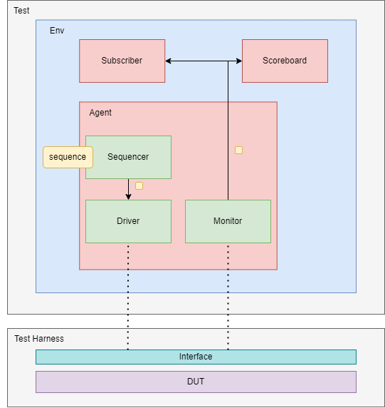

# UVM-ALU-verification

This repository contains a SystemVerilog UVM environment for verifying a simple synchronous ALU (8-bit inputs `A` and `B`, 4-bit opcode `ALUSel`, 16-bit output `F`, and carry flag `cout`).

The testbench is set up to run using **Verilator** (with `uvm_pkg` 1800.2) and generates coverage reports via `verilator_coverage` and `lcov`.

## Overview

- **DUT (`src/design.sv`):** Supports addition, subtraction, multiplication, and division, with an asynchronous active-high reset and a default `16'h00AC` output for reserved opcodes (`4` to `15`).
- **Interface (`src/interface.sv`):** Uses `drv_cb` and `mon_cb` clocking blocks to avoid race conditions between the testbench and RTL.
- **UVM Environment (`src/`):**
  - `alu_agent`: Wraps the sequencer, driver, and a pipelined monitor that samples back-to-back single-cycle transactions.
  - `alu_scoreboard`: Queue-based reference model checking 16-bit results and carry-out flags using 4-state (`!==`) comparisons.
  - `alu_subscriber`: Samples functional coverpoints for opcodes, operand boundaries (`0`, `1..254`, `255`), 16-bit result ranges, and carry-out.
  - `alu_sequence`: Includes reset, constrained-random (`alu_test_sequence`), reserved opcode (`alu_illegal_op_sequence`), and directed corner-case (`alu_corner_sequence`) sequences.


### Environment Structure


## Running the Simulation

Make sure `VERILATOR_ROOT` and `UVM_ROOT` in the `Makefile` point to your local Verilator and UVM installations, then run:

```bash
# Compile and run the simulation
make run

# Run simulation and generate Verilator + LCOV HTML coverage reports
make coverage

# Clean build artifacts
make clean
```

## Coverage Results

Code coverage on the RTL (`src/design.sv`) and functional coverage in the subscriber (`src/subscriber.sv`) both reach 100%:

| Metric | Coverage | Details |
| :--- | :--- | :--- |
| **Line Coverage** | 100.0% | 7/7 Verilator points (47/47 LCOV annotated lines) |
| **Branch Coverage** | 100.0% | 4/4 Verilator branches (150/150 LCOV branches) |
| **Toggle Coverage** | 100.0% | 128/128 bits |
| **Expression Coverage** | 100.0% | 2/2 expressions |
| **Functional Covergroup (`cg`)** | 100.0% | 38/38 bins (`op_cp`, `rel_cp`, `op_x_rel`, `a_cp`, `b_cp`, `result_cp`, `cout_cp`) |